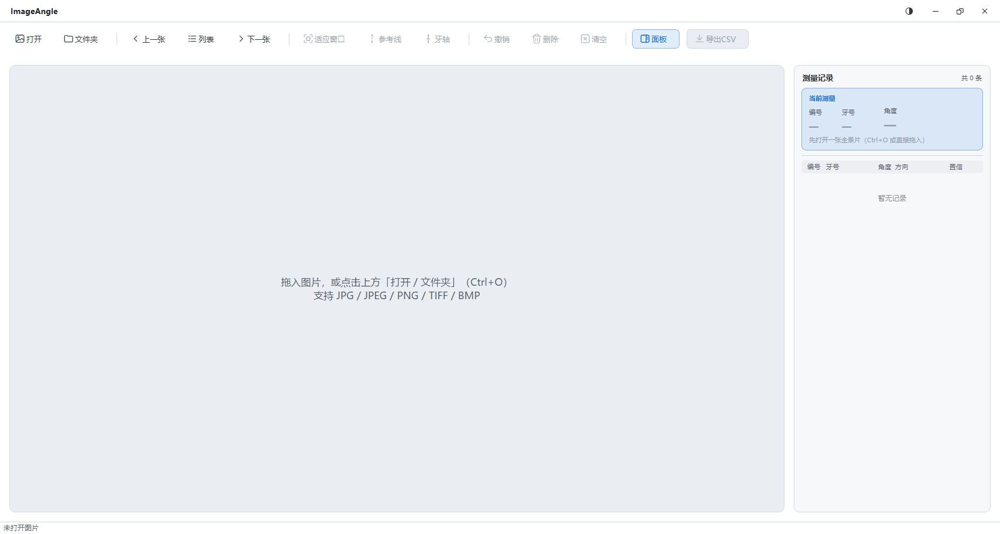

# ImageAngle · 全景片牙齿倾角测量

在口腔全景片上画一条参考线（比如咬合平面的垂线）和一条牙长轴，程序就会即时给出这颗牙的**近远中轴倾角**，并自动判定**正负**与「近中 / 远中」——判定依据是牙轴落在参考线哪一侧、画线方向是不是从牙根到牙冠，不需要你先声明上下颌。



手工用量角器在全景片上量牙轴倾角，既慢、不同人量的结果又不一致。这个工具只做一件事：把「量准一根线」变成可复现、可留档、可导出的数字。

纯本地运行，不联网、不上传任何影像。

## 功能

- **两点画线**：参考线 + 牙长轴，拖任意端点随时微调，角度实时跟随
- **自动判近中 / 远中**：几何优先（看牙轴在参考线哪一侧），牙号（FDI）只用来兜底校验；两者矛盾时打 `fdi_conflict` 标记而不是硬算
- **按牙记录**：右侧记录列表显示每颗牙的角度、方向、置信度，点选可回到画布定位
- **撤销 / 删除 / 清空**：清空需二次确认，快捷键 `Ctrl+Shift+Del`
- **整目录翻页**：打开文件夹后 `上一张 / 下一张`，列表里显示每张图「已测 N 条 / 未测」
- **16 位 TIFF**：全景机导出的高位深片子按 0.5%~99.5% 分位拉伸显示，位深不丢
- **CSV 导出**：UTF-8 BOM，Excel 直接双击打开中文不乱码；含坐标与标记位，可回溯
- **深 / 浅双主题**、高 DPI 适配、无边框窗口（含 Windows 11 原生圆角）
- **会话自动保存**：关掉再开，已测的图和线都还在
- **使用说明**（`F1`）：版本、是否开源；两个折叠栏 —— 打赏作者（微信 / 支付宝收款码）、
  使用说明（点选顺序、读数含义、算法要点）

## 下载

到本仓库的 **Releases** 页面选一个，不用装 Python：

| 文件 | 体积 | 适合谁 |
|---|---|---|
| 便携包 · `ImageAngle-1.1.0-便携包.exe`（GitHub 上是 `-Portable.exe`） | 32.9 MB | 单文件，拷贝到任何 Windows 10/11 机器双击即用，免安装 |
| 安装包 · `ImageAngle-1.1.0-安装包.exe`（GitHub 上是 `-Setup.exe`） | 22.9 MB | 装到当前用户目录（**不需要管理员**），有开始菜单 / 桌面快捷方式和卸载项 |

GitHub 的附件名不支持非 ASCII 字符，中文包名会被剔成空（`ImageAngle-1.1.0-.exe`），所以那边用 `-Portable` / `-Setup`；Gitee 保留中文名。两个站点的文件内容完全一致，本地 `py scripts/build.py` 产出的也是中文名。

两个包功能完全相同，测量记录也互通（都存在 `%APPDATA%\ImageAngle`）。安装版启动更快（约 0.57 s vs 1.4 s），因为单文件版每次启动都要把 81 MB 运行时解压到临时目录。

## 从源码运行

```bash
py -m pip install -r requirements.txt
py run.py            # 或双击 启动.bat
py -m pytest -q      # 跑测试（198 例）
```

需要 Python 3.10+（开发与打包用 3.12）、PySide6、numpy。

## 角度是怎么算的

设参考线方向为单位向量 `u`，牙长轴从牙根 `R` 指向牙冠 `C`：

- **幅值**：`|normalize(axis_deg − reference_deg)|`，落在 0°~90°。竖直的牙轴配斜的参考线，得到的就是两者夹角，与线朝上还是朝下无关
- **侧别**：叉积有向距离 `s = u.x·(R.y−D.y) − u.y·(R.x−D.x)`（`D` 为参考线另一端点）。`s` 的符号与取哪个端点无关，只由「牙轴在参考线左侧还是右侧」决定
- **方向**：`dx = crown.x − root.x`。牙冠在牙根右边 → 画面右侧，反之左侧；左右 + 侧别 → 近中 / 远中
- **正负**：近中为正、远中为负；幅值小于死区角度时方向不可判，显示 `—` 而不是猜一个

早期版本按「角度差的正负」判方向，上颌会 100% 反号——因为归一化把上下朝向的信息丢掉了。现在的实现只让上下颌参与象限命名，不参与符号计算；`tests/test_sign_fix.py` 用四个象限的用例锁住这一点。

## 快捷键

| 键 | 作用 |
|---|---|
| `Ctrl+O` / `Ctrl+E` | 打开图片 / 导出 CSV |
| `Ctrl+0` / `Ctrl+1` | 适应窗口 / 实际像素 100% |
| `R` / `T` | 画参考线 / 画牙长轴 |
| `Ctrl+Z` | 撤销上一条 |
| `Del` / `Ctrl+Shift+Del` | 删除选中记录 / 清空所有线（需确认） |
| `L` | 图片列表 |
| `F1` | 使用说明（展开后含打赏作者） |

## 文件结构

- `run.py` — 程序入口。PyInstaller 必须从这里启动，直接执行 `app/main.py` 会破坏相对导入。
- `app/` — 应用包，下分界面、领域模型、输入输出三层。
- `app/main.py` — 启动流程：日志、高 DPI、旧数据迁移、样式表、主窗口。
- `app/applog.py` — 运行日志写到 `%APPDATA%\ImageAngle\app.log`（1 MB × 3 轮转），并接管全局异常。
- `app/ui/` — Qt 界面：主窗口、画布（缩放 / 平移 / 拖点）、结果面板、自绘标题栏、主题令牌、SVG 图标工厂、使用说明对话框。
- `app/model/` — 纯逻辑，不 import Qt：角度计算、会话 / 图像 / 牙齿数据模型、FDI 与备注常量。
- `app/io/` — 图片加载（`QImageReader`，支持中文路径与 16 位 TIFF）、CSV 导出、用户数据目录定位与迁移。
- `ImageAngle.spec` — 便携包（单文件）的 PyInstaller 配置。
- `packaging/` — 打包辅助：Qt 裁剪规则、目录版 spec、Windows 版本资源。
- `packaging/qt_prune.py` — Analysis 之后过滤 `a.binaries` / `a.datas`。只靠 `excludes` 删不掉 Qt 的 DLL，因为 PySide6 的 hook 是直接扫包目录收文件的。
- `packaging/onedir.spec` — 目录版 spec，安装包由它产出。
- `installer/` — Inno Setup 脚本与简体中文语言包。
- `scripts/` — 开发脚本：`build.py`（一次出两个包）、图标与示例片生成。
- `tests/` — 198 项 pytest，全部离屏运行，含金标准用例、符号修复四象限、打包规则守卫。
- `tools/` — 离屏渲染工具，用来出截图和做视觉核对。
- `docs/` — 设计方案、界面草图与截图。
- `启动.bat` / `测试.bat` — 不敲命令就能启动程序和跑测试的 Windows 批处理。

## 打包发布

```bash
py -m pip install -U pyinstaller
py scripts/build.py              # 一次出两个包，约 110 秒
py scripts/build.py --portable   # 只出便携包
py scripts/build.py --setup      # 只出安装包（需要 Inno Setup 6）
```

产物名固定为「名称 + 版本 + 包类型」，版本号只来自 `app/__init__.py`。两个包共用 `packaging/qt_prune.py` 的裁剪规则——单文件版 100 MB 曾经有 42 MB 是只用过 3 个函数的 OpenCV，现在已彻底移除，解码改走 Qt 自带的图像插件。

## 数据与隐私

- 影像只在内存里解码显示，不写副本、不上传
- 测量记录存 `%APPDATA%\ImageAngle\session.json`，窗口位置与主题各存一个 json
- 卸载程序**不会**删除这些记录；要清空请手动删该目录
- 日志只记启动、开关图、异常，不含影像内容与患者信息

## 第三方

- `installer/ChineseSimplified.isl` — Inno Setup 简体中文语言包，取自
  [kira-96/Inno-Setup-Chinese-Simplified-Translation](https://github.com/kira-96/Inno-Setup-Chinese-Simplified-Translation)
- 运行依赖 PySide6（LGPLv3）与 numpy（BSD-3-Clause），打包产物中保留其许可证

## 镜像与反馈

- GitHub：<https://github.com/ASH-C776/ImageAngle>
- Gitee：<https://gitee.com/kijeye/ImageAngle>
- 问题反馈走任一仓库的 Issues 都可以，两个站点的代码与发行版同步

## License

MIT，见 [LICENSE](LICENSE)。
